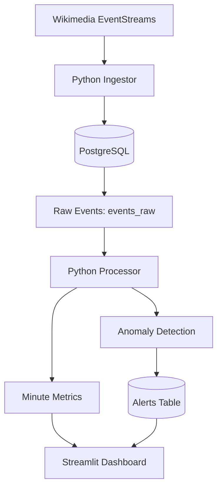

# ⚡ Realtime Metrics Platform

**A real-time event ingestion, processing, anomaly detection, and monitoring platform powered by Wikimedia EventStreams, Python, PostgreSQL, and Streamlit.**

<p align="center">
  
  
  
  
</p>

<p align="center">
  <a href="#-overview">Overview</a> ·
  <a href="#-architecture">Architecture</a> ·
  <a href="#-features">Features</a> ·
  <a href="#-quick-start">Quick Start</a> ·
  <a href="#-database">Database</a> ·
  <a href="#-roadmap">Roadmap</a>
</p>

---

## 📌 Overview

The Realtime Metrics Platform collects live Wikimedia recent-change events, stores raw event data in PostgreSQL, processes activity metrics, identifies potential anomalies, and presents results through a Streamlit dashboard.

The project demonstrates a practical data engineering workflow involving streaming ingestion, relational data storage, scheduled or continuous metric processing, statistical anomaly detection, and data visualization.

### Why this project?

- **Live data:** Consume real events from Wikimedia EventStreams.
- **Data engineering:** Build an ingestion-to-processing pipeline.
- **Analytics:** Aggregate event activity into minute-level metrics.
- **Anomaly detection:** Use statistical z-scores to flag unusual activity.
- **Monitoring:** Explore metrics and alerts through a web dashboard.

## 🏗️ Architecture



### Pipeline stages

| Stage | Component | Responsibility |
|---|---|---|
| 1. Ingestion | `ingestor.py` | Read live events and insert raw records |
| 2. Storage | PostgreSQL | Persist events and processed metrics |
| 3. Processing | `processor.py` | Aggregate events into minute-level metrics |
| 4. Detection | Statistical z-score logic | Identify potentially unusual activity |
| 5. Visualization | `app.py` | Display metrics and alerts in a dashboard |

## ✨ Features

- [x] Live Wikimedia recent-change event ingestion
- [x] PostgreSQL-based event storage
- [x] Duplicate event protection using event IDs
- [x] Minute-level activity aggregation
- [x] Statistical anomaly detection using z-scores
- [x] Alert persistence in PostgreSQL
- [x] Streamlit dashboard
- [x] Environment-based database configuration

> **Note:** Features and operational guarantees should be verified against the current implementation before describing the project as production-ready.

## 🧰 Technology Stack

| Technology | Purpose |
|---|---|
| Python | Ingestion and processing logic |
| Wikimedia EventStreams | Live event source |
| PostgreSQL | Persistent data storage |
| Psycopg 2 | PostgreSQL connectivity |
| Streamlit | Interactive analytics dashboard |
| Pandas | Tabular data handling and analytics |
| Python-dotenv | Environment configuration |

## 🚀 Quick Start

### 1. Prerequisites

Install the following:

- Python 3.12 or later, compatible with your dependencies
- PostgreSQL
- Git
- A web browser

The project was developed in a Python 3.14 virtual environment. If a dependency is incompatible with your Python version, use a compatible supported version.

### 2. Clone the repository

```bash
git clone https://github.com/YOUR_USERNAME/realtime-metrics-platform.git
cd realtime-metrics-platform
```

Replace `YOUR_USERNAME` with your GitHub username.

### 3. Create and activate a virtual environment

**Windows PowerShell**

```powershell
python -m venv .venv
.\.venv\Scripts\Activate.ps1
```

**macOS / Linux**

```bash
python3 -m venv .venv
source .venv/bin/activate
```

### 4. Install dependencies

```bash
python -m pip install --upgrade pip
pip install -r requirements.txt
```

### 5. Configure PostgreSQL

Create a PostgreSQL database named `realtime_metrics`.

Create a `.env` file in the project root using the variable names expected by your application.

Example configuration — **adjust the variable names to match your code**:

```dotenv
DB_HOST=localhost
DB_PORT=5432
DB_NAME=realtime_metrics
DB_USER=postgres
DB_PASSWORD=YOUR_LOCAL_DATABASE_PASSWORD
```

Never commit your actual `.env` file or database credentials.

### 6. Initialize the database schema

Inspect `migrate_schema.py` and follow its documented usage if it provides schema migrations. Otherwise, create the tables using the project's existing database setup instructions.

### 7. Run the pipeline

Open three separate terminals from the project directory and activate the virtual environment in each.

**Terminal 1 — Event ingestion**

```powershell
python ingestor.py
```

**Terminal 2 — Metric processing**

```powershell
python processor.py
```

**Terminal 3 — Dashboard**

```powershell
python -m streamlit run app.py
```

Open the local URL printed by Streamlit, usually:

**http://localhost:8501**

Run only one instance of each service unless you have explicitly configured multiple workers.

## 🗄️ Database

The project uses PostgreSQL to persist raw events, aggregated metrics, and alerts.

| Table / object | Purpose |
|---|---|
| `events_raw` | Raw ingested Wikimedia events |
| `metric_minute_processed` | Processed minute-level metrics |
| `metric_minute` | Database view, if present in the current schema |
| `alerts` | Detected anomalies and their status |

The exact columns, constraints, indexes, and relationships are defined by the database schema in the repository.

### Example diagnostic queries

Inspect the volume of ingested events:

```sql
SELECT COUNT(*) AS total_events
FROM events_raw;
```

Inspect the number of stored alerts:

```sql
SELECT status, COUNT(*) AS alert_count
FROM alerts
GROUP BY status
ORDER BY alert_count DESC;
```

Inspect the latest alerts:

```sql
SELECT *
FROM alerts
ORDER BY fired_at DESC
LIMIT 20;
```

## 📊 Dashboard

The Streamlit application provides a browser-based interface for monitoring processed data and alerts.

**Local dashboard:** `http://localhost:8501`

Add your own dashboard screenshot to `docs/screenshots/dashboard.png` and embed it below:

```markdown

```

Only include a screenshot after adding the actual image file to the repository.

## 🔐 Configuration and Security

- Store database credentials in `.env`.
- Keep `.env` out of version control.
- Commit `.env.example` with placeholder values only.
- Never publish passwords, API tokens, or connection strings.
- Use a dedicated database role with only the permissions required.
- Review logs to ensure credentials are not printed.
- Back up important data before applying schema migrations.

## 🧪 Testing and Validation

Run the project's database connectivity check, if supported:

```bash
python db_test.py
```

Before considering the system stable, verify:

- Database connectivity and schema initialization
- Event ingestion during network interruptions
- Duplicate event handling
- Metric aggregation across minute boundaries
- Anomaly detection behavior
- Alert deduplication and status updates
- Dashboard behavior when tables are empty
- Recovery after restarting each process

## 🗺️ Roadmap

Potential future improvements:

- [ ] Automated tests for ingestion and processing
- [ ] Reliable retry and reconnection handling
- [ ] Stronger alert deduplication and lifecycle management
- [ ] Configurable anomaly thresholds
- [ ] Historical trend analysis
- [ ] Structured application logging and health checks
- [ ] Docker Compose deployment
- [ ] CI workflow for linting and automated tests
- [ ] Deployment and monitoring documentation

## 🧯 Troubleshooting

<details>
<summary><strong>PostgreSQL connection errors</strong></summary>

- Confirm the PostgreSQL service is running.
- Verify the database name, host, port, and username.
- Check the `.env` variable names used by the code.
- Run `python db_test.py` if the test script supports the current configuration.

</details>

<details>
<summary><strong>No events appearing</strong></summary>

- Check the ingestor terminal for connection errors.
- Verify internet connectivity.
- Confirm the Wikimedia EventStreams endpoint is reachable.
- Check whether new events are being inserted into `events_raw`.

</details>

<details>
<summary><strong>Dashboard does not load</strong></summary>

- Activate the virtual environment.
- Run `pip install -r requirements.txt`.
- Start the dashboard with `python -m streamlit run app.py`.
- Open the local URL printed in the terminal.

</details>

<details>
<summary><strong>Repeated anomaly alerts</strong></summary>

- Inspect the processor's anomaly detection and deduplication logic.
- Check the alert schema and its uniqueness constraints.
- Compare alert creation timestamps with the source metric timestamps.
- Preserve existing records while investigating duplicate generation.

</details>

## 🤝 Contributing

Contributions, bug reports, and suggestions are welcome.

1. Fork the repository.
2. Create a feature branch.
3. Make and test your changes.
4. Submit a pull request describing the change.

## 📄 License

No license has been specified yet. Add a `LICENSE` file before presenting the project as open source.

## 👨‍💻 Author

**Yugesh**

- GitHub: [@yugesh23](https://github.com/yugesh23)
- LinkedIn: [Hari Sai Yugesh](https://www.linkedin.com/in/hari-sai-yugesh-5299b12b9/)

---

<p align="center">
  <strong>Built to explore real-time data engineering and analytics.</strong>
</p>
